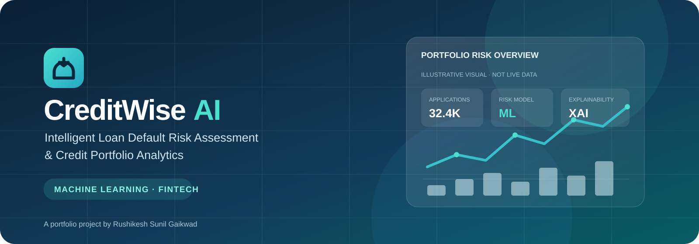
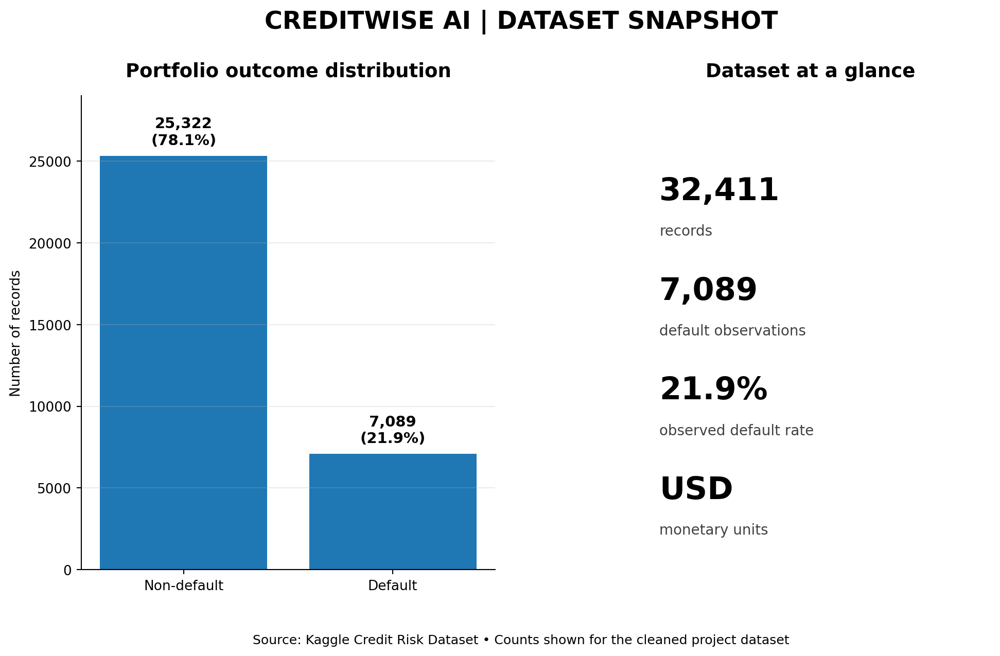
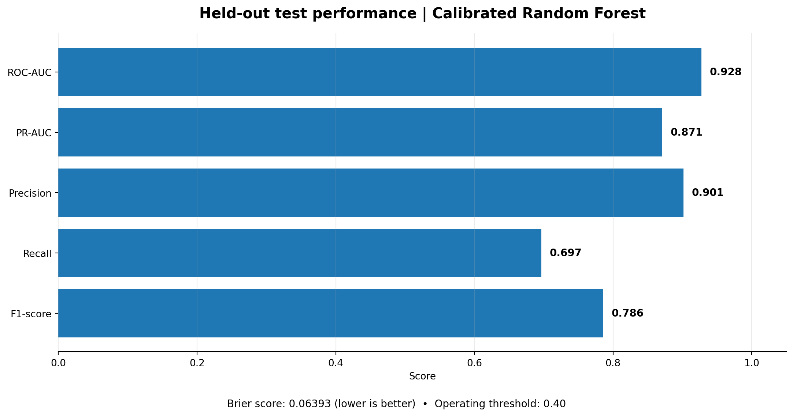
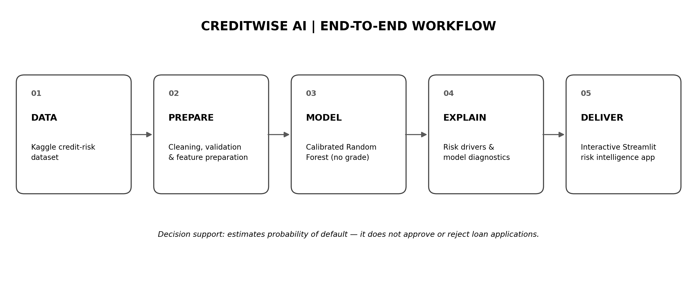
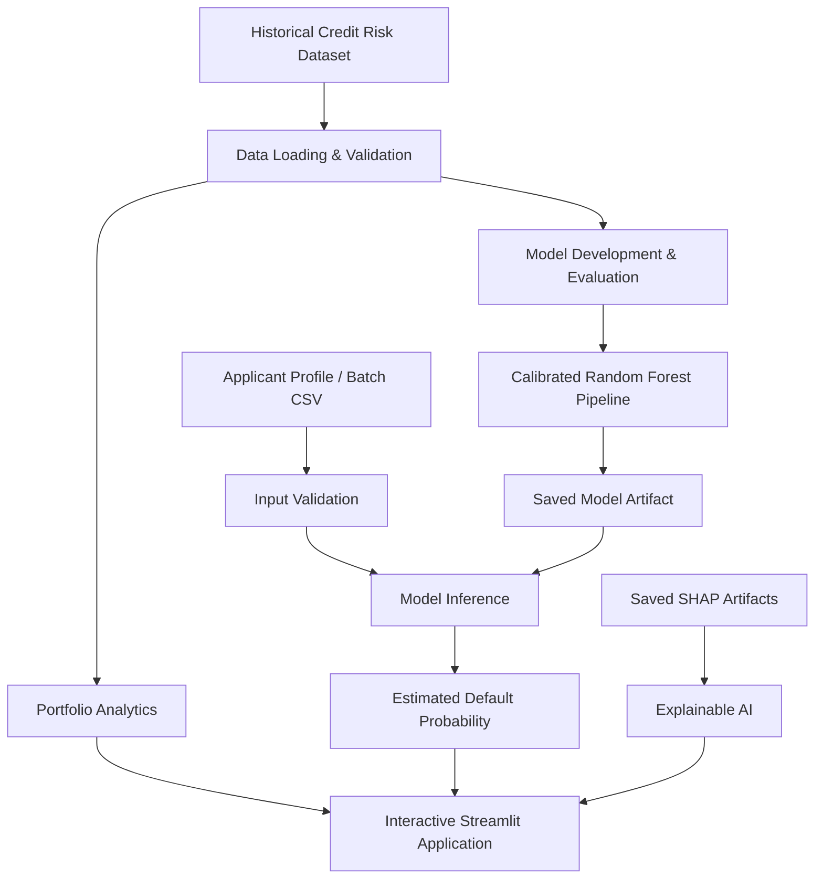
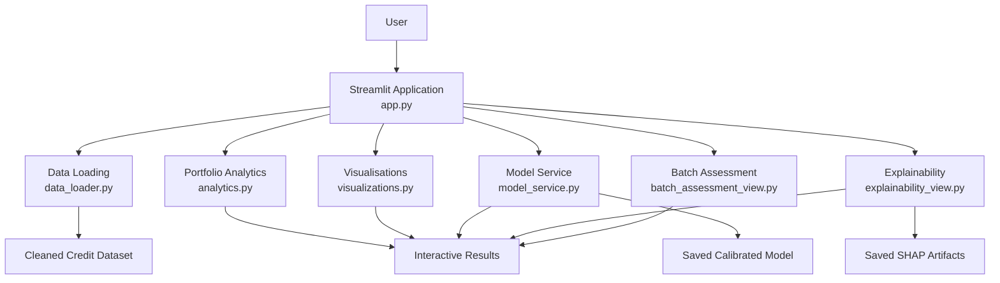

 
<div align="center">



# CREDITWISE AI

### Intelligent Loan Default Risk Assessment & Credit Portfolio Analytics

**Turning Historical Credit Data into Actionable Risk Insights.**

An interactive Machine Learning and Business Analytics application designed to explore credit-risk patterns, estimate loan-default probabilities, and support data-driven portfolio analysis.

<p>
  <a href="https://creditwiseaii.streamlit.app/">
    
  </a>
  <a href="https://github.com/rushikeshgaikwad2026-glitch/CreditWise-AI">
    
  </a>
</p>

<p>
  
  
  
  
  
</p>

**Designed & Developed by Rushikesh Sunil Gaikwad**

[LinkedIn](https://www.linkedin.com/in/rushikesh-s-gaikwad) · [GitHub](https://github.com/rushikeshgaikwad2026-glitch) · [Portfolio](https://rushikesh-gaikwad-executive-presence-332392968552.asia-southeast1.run.app/)

</div>

---

## 📌 Project Overview

Credit decisions require a balance between lending opportunities, borrower characteristics, repayment behaviour, and portfolio risk.

CreditWise AI brings these analytical dimensions into one interactive application by combining machine learning, portfolio analytics, applicant-level assessment, batch processing, and explainable AI.

The application uses a saved, calibrated Random Forest classification pipeline to estimate the probability of the historical loan-default outcome.

It is designed as an end-to-end portfolio project demonstrating how data science and business analytics can be translated into an interactive financial-services use case.

### Project at a glance

| Component | Description |
|---|---|
| Project | CreditWise AI |
| Business domain | Financial Services & Credit Risk Analytics |
| Application | Interactive Streamlit Web Application |
| Machine Learning | Calibrated Random Forest Classifier |
| Explainability | SHAP-based model analysis |
| Data source | Kaggle Credit Risk Dataset |
| Deployment | Streamlit Community Cloud |
| Primary objective | Loan-default probability estimation and portfolio exploration |

---

## 🎯 The Business Problem

Financial institutions need to understand borrower profiles, identify historical repayment patterns, and assess potential credit risk.

CreditWise AI explores how machine learning and business analytics can help investigate questions such as:

- What proportion of historical loan applications resulted in default?
- Which borrower and loan characteristics are associated with different historical outcomes?
- How does the observed default rate vary across loan purposes and borrower segments?
- What default probability does the trained model estimate for an applicant profile?
- Which features influence the behaviour of the underlying model?
- How can multiple applicant records be assessed consistently?

**The objective:** Demonstrate an analytical workflow that transforms historical credit data into understandable portfolio insights and model-based risk estimates.

---

## ✨ Core Application Capabilities

CreditWise AI is organised into five interactive modules.

### 1. 📊 Executive Dashboard

<details>
<summary><b>Explore dashboard capabilities</b></summary>

- Total loan applications.
- Default and non-default counts.
- Observed portfolio default rate.
- Average loan amount and annual income.
- Historical application outcome distribution.
- Default-rate comparisons across loan purpose, income, and home-ownership categories.
- Interactive filtering by loan purpose and home ownership.

The dashboard provides a consolidated view of the historical credit portfolio.

</details>

### 2. 👤 Applicant Risk Assessment

<details>
<summary><b>Explore applicant assessment capabilities</b></summary>

Evaluate an individual applicant profile using the saved calibrated classification pipeline.

Applicant characteristics include:

- Age and annual income.
- Home ownership and employment length.
- Loan purpose and loan amount.
- Interest rate and loan-to-income ratio.
- Previous default indicator.
- Credit-history length.

The application validates input fields against the model's expected feature schema and returns an estimated probability of the historical default class.

**Important:** The model provides a probability estimate, not an automated lending approval or rejection.

</details>

### 3. 📈 Portfolio Analytics

<details>
<summary><b>Explore portfolio analysis capabilities</b></summary>

Investigate historical credit patterns through interactive analytical views.

- Loan-purpose analysis.
- Home-ownership comparisons.
- Loan-grade analysis.
- Applicant age and income patterns.
- Loan-amount analysis.
- Employment-length comparisons.
- Observed default-rate analysis across selected segments.
- Portfolio summary indicators and downloadable analytical summaries where available.

</details>

### 4. 🧠 Explainable AI

<details>
<summary><b>Explore model explainability capabilities</b></summary>

Understand the behaviour of the underlying model through saved SHAP analysis artifacts.

- Global feature-importance summaries.
- SHAP summary visualisation.
- Saved example applicant profiles.
- Positive and negative feature-attribution tables.
- Applicant-level explanation visualisations.

**Technical distinction:** The saved SHAP artifacts explain the raw class-1 output of the first fold-specific Random Forest. They do not mathematically decompose the complete isotonic-calibrated ensemble probability displayed in Applicant Risk Assessment.

SHAP feature attribution describes model behaviour; it does not establish causation.

</details>

### 5. 📁 Batch Assessment

<details>
<summary><b>Explore batch processing capabilities</b></summary>

Assess multiple applicant records through a CSV-based workflow.

- CSV input-column inspection.
- Applicant data validation.
- Individual record assessment.
- Identification of valid and invalid records.
- Estimated probability distribution.
- Risk-category summaries.
- Downloadable assessment output where available in the application.

The target column `loan_status` is not required for applicant assessment and is not used as a prediction input.

</details>

---

## 🖼️ Project Visual Showcase

The following visuals illustrate the dataset, model evaluation, and end-to-end workflow behind CreditWise AI.

### 01 — Dataset Overview

Understanding the underlying dataset is the first step in developing a reliable analytical solution.



*Historical credit dataset snapshot and data overview.*

### 02 — Held-Out Test Performance

Model evaluation on held-out test data provides an assessment of how the trained model performs on data not used for fitting.



*Held-out test performance and model evaluation results.*

### 03 — End-to-End Credit Risk Workflow

A structured workflow connects data preparation, model development, evaluation, prediction, and analytical presentation.



*End-to-end machine-learning and credit-risk assessment workflow.*

---

## 🔄 How CreditWise AI Works

The application connects historical portfolio analysis with individual and batch applicant assessment.



---

## 🤖 Machine Learning Approach

CreditWise AI uses a **calibrated Random Forest classification pipeline** to estimate the probability of class `1` in the historical `loan_status` target.

### Model development workflow

1. Load and validate the cleaned historical credit dataset.
2. Prepare features for model development.
3. Train and evaluate classification candidates.
4. Calibrate the selected model's probability estimates.
5. Save the fitted model pipeline.
6. Load the saved model artifact into the Streamlit application.
7. Validate applicant inputs against the expected feature schema.
8. Generate the estimated probability for the default class.

### Model integration safeguards

The application checks that the saved model:

- Exposes a `predict_proba()` method.
- Contains the expected fitted feature names.
- Includes the default class (`1`).
- Does not use `loan_grade` as a prediction input.

### Model evaluation

The project includes a held-out test performance evaluation to examine model behaviour beyond the training data.

The evaluation visual is included above to make the model assessment process transparent.

Model performance should always be interpreted in the context of class distribution, validation methodology, probability calibration, and the limitations of the underlying historical dataset.

---

## 🔎 Explainable AI — Understanding Model Behaviour

A machine-learning prediction becomes more useful when its underlying behaviour can also be investigated.

CreditWise AI integrates saved SHAP artifacts to demonstrate feature attribution at both global and selected applicant-profile levels.

The explainability module helps explore:

- Which features have greater influence on the explained model output.
- How individual feature values contribute positively or negatively.
- How model behaviour differs across selected example profiles.

**Interpretation limitations**

- Feature attribution is not proof of causation.
- Saved SHAP explanations concern the first fold-specific forest's raw output.
- They do not reconstruct the full calibrated ensemble probability displayed by the applicant assessment workflow.
- Feature importance alone does not establish that a feature is appropriate for a real lending policy.

---

## 🏗️ Application Architecture

The application follows a modular architecture that separates the user interface from the underlying analytical and machine-learning services.



### Architecture principles

- Modular application components.
- Dedicated data-loading and validation services.
- Separate model inference logic.
- Reusable analytical and visualisation functions.
- Dedicated explainability and batch-processing workflows.
- Clear distinction between model output and lending decisions.

---

## 🛠️ Technology Stack

| Category | Technology | Application |
|---|---|---|
| Programming | Python | Application development |
| Web framework | Streamlit | Interactive web application |
| Data analysis | Pandas | Data preparation and analytics |
| Numerical computing | NumPy | Numerical operations |
| Machine Learning | Scikit-learn | Classification and probability prediction |
| Visualisation | Plotly | Interactive analytical charts |
| Model persistence | Joblib | Saved model loading |
| Image support | Pillow | Image handling |
| Explainable AI | SHAP artifacts | Model feature attribution |
| Version control | Git & GitHub | Source-code management |
| Deployment | Streamlit Community Cloud | Online application hosting |

### Dependency versions

The project's `requirements.txt` specifies:

```text
streamlit==1.67.0
pandas==3.1.1
numpy==2.5.4
scikit-learn==1.9.1
joblib==1.6.0
plotly==7.1.0
pillow==13.0.0
```

---

## 🚀 Run CreditWise AI Locally

### Prerequisites

- Python environment compatible with the pinned dependencies.
- Git installed on your system.
- Required dataset and saved model artifacts.

### 1. Clone the repository

```bash
git clone https://github.com/rushikeshgaikwad2026-glitch/CreditWise-AI.git

cd CreditWise-AI
```

### 2. Create a virtual environment

**Windows PowerShell**

```powershell
py -m venv .venv

.\.venv\Scripts\Activate.ps1
```

**macOS / Linux**

```bash
python3 -m venv .venv

source .venv/bin/activate
```

### 3. Install dependencies

```bash
python -m pip install --upgrade pip

pip install -r requirements.txt
```

### 4. Verify required project assets

The application expects the cleaned dataset and saved model at:

```text
data/processed/credit_risk_cleaned.csv

models/credit_risk_rf_optimized_calibrated_no_loan_grade.joblib
```

The Explainable AI section also requires its saved SHAP analysis artifacts.

Keep all required project assets in their expected locations.

### 5. Launch the application

```bash
python -m streamlit run app.py
```

Open the local Streamlit URL:

```text
http://localhost:8501
```

---

## 📂 Project Structure

```text
CreditWise-AI/
│
├── app.py
├── requirements.txt
├── README.md
│
├── assets/
│   ├── creditwise-banner.svg
│   ├── dataset-overview.png
│   ├── model-performance.png
│   └── credit-risk-workflow.png
│
├── data/
│   ├── raw/
│   └── processed/
│       └── credit_risk_cleaned.csv
│
├── models/
│   └── credit_risk_rf_optimized_calibrated_no_loan_grade.joblib
│
├── notebooks/
│   └── Model development and analysis notebooks
│
├── reports/
│   └── Model evaluation and analysis outputs
│
└── src/
    ├── __init__.py
    ├── analytics.py
    ├── batch_assessment.py
    ├── batch_assessment_view.py
    ├── data_loader.py
    ├── explainability.py
    ├── explainability_view.py
    ├── model_service.py
    ├── validation.py
    └── visualizations.py
```

*Note: The tree highlights the main application files and referenced assets. Some data, model, notebook, and report subdirectories are represented by their key files rather than every generated artifact.*

---

## 📚 Dataset & Data Source

**Source:** [Credit Risk Dataset — Kaggle](https://www.kaggle.com/datasets/laotse/credit-risk-dataset)

The dataset contains historical borrower and loan attributes, including applicant characteristics, loan information, credit-history indicators, and the historical loan-status target.

| Target value | Meaning |
|---|---|
| `loan_status = 0` | Non-default outcome |
| `loan_status = 1` | Default outcome |

Monetary amounts are represented in USD in this project.

The dataset is used for educational analysis and model-development demonstration. It should not be assumed to represent a current lending population or any particular financial institution's portfolio.

---

## 🛡️ Responsible AI & Limitations

CreditWise AI is an independent educational and portfolio project.

The application demonstrates analytical and predictive techniques but is not a production lending or underwriting system.

Important considerations:

- Predictions are estimated probabilities, not guaranteed outcomes.
- The application does not approve, reject, price, or underwrite loans.
- Historical datasets may contain sampling limitations and biases.
- Differences between borrower groups do not establish causation or discrimination.
- SHAP values describe model attribution, not causal effects.
- Saved SHAP explanations do not decompose the full calibrated ensemble probability displayed by the applicant assessment page.
- Real-world credit-risk deployment would require appropriate validation, governance, privacy, security, fairness assessment, and regulatory review.

**CreditWise AI should not be used as the sole basis for a real lending or financial decision.**

---

## 🎓 Skills Demonstrated

This project demonstrates the integration of business understanding, data analytics, machine learning, and application development.

### Business & Analytical Skills

- Financial-services problem understanding.
- Credit-risk and portfolio analytics.
- KPI development and interpretation.
- Business intelligence and dashboard storytelling.
- Segment-level performance analysis.
- Data-driven decision support.
- Communicating analytical insights and limitations.

### Technical Skills

- Python application development.
- Data preparation and validation.
- Machine-learning classification.
- Probability calibration and model integration.
- Explainable AI using SHAP artifacts.
- Interactive dashboard development.
- Batch data validation and prediction workflows.
- Modular application architecture.
- Git, GitHub, and Streamlit deployment.

---

## 👨‍💻 About the Creator

<div align="center">

### Rushikesh Sunil Gaikwad

**MBA – Marketing | Machine Learning | Business Analytics | Financial Services**

</div>

CreditWise AI was independently conceptualised and developed by **Rushikesh Sunil Gaikwad** as a portfolio project exploring the practical intersection of:

- Machine Learning
- Credit Risk Analytics
- Explainable AI
- Business Intelligence
- Financial Services
- Data-Driven Decision Support

The project reflects an interest in translating business problems into practical analytical solutions by combining business thinking, data science, and interactive application development.

### Connect with me

| Platform | Link |
|---|---|
| LinkedIn | [Rushikesh Gaikwad](https://www.linkedin.com/in/rushikesh-s-gaikwad) |
| GitHub | [rushikeshgaikwad2026-glitch](https://github.com/rushikeshgaikwad2026-glitch) |
| Professional Portfolio | [Explore My Portfolio](https://rushikesh-gaikwad-executive-presence-332392968552.asia-southeast1.run.app/) |
| Live Application | [Launch CreditWise AI](https://creditwiseaii.streamlit.app/) |
| Source Code | [CreditWise AI Repository](https://github.com/rushikeshgaikwad2026-glitch/CreditWise-AI) |

### Dataset Acknowledgement

The underlying Credit Risk Dataset is sourced from [Kaggle](https://www.kaggle.com/datasets/laotse/credit-risk-dataset).

CreditWise AI is an independent analysis and application built using this public dataset. It is not affiliated with or endorsed by the dataset publisher.

---

<div align="center">

## CreditWise AI

### Turning Credit Data into Risk Insights.

**Built with Python · Machine Learning · Business Analytics**

Created with curiosity, analytical thinking, and a passion for solving business problems through technology.

**© Rushikesh Sunil Gaikwad**

[LinkedIn](https://www.linkedin.com/in/rushikesh-s-gaikwad) · [GitHub](https://github.com/rushikeshgaikwad2026-glitch) · [Portfolio](https://rushikesh-gaikwad-executive-presence-332392968552.asia-southeast1.run.app/)

</div>